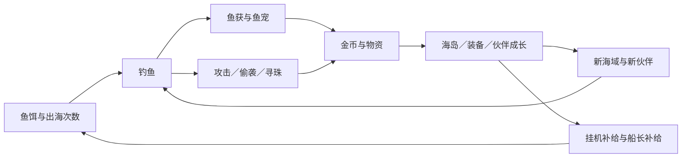

# 0.12 核心循环复查

此页保留 0.12 的历史状态。0.15 已补充主题航海、建设能力、本轮小结、对手线索、外观／灯会消耗与好友合作，最新规则及边界见 [0.15 核心循环](CORE_LOOP_V015.md)。

当前可玩循环已经连通，但中长期内容与经济仍不能视为最终完成。

| 环节 | 已落实 | 当前限制 |
| --- | --- | --- |
| 出海与投入 | SPIN 找点、点击鱼群直接开钓、AUTO、倍率、后台暂停与保底 | 移动与触控性能需实体手机验证 |
| 鱼获与收藏 | 六海域、36 鱼种、首次解锁鱼宠、重量纪录、新发现保底、收藏奖励 | 全鱼种收集后，新增收藏目标仍依赖内容更新 |
| 随机事件 | 攻击、独立偷袭、贝壳匹配、补给、护盾、区域奇遇；中断可续 | 每周委托提供回访目标，但还不是完整的主题活动体系 |
| 对手与反馈 | 四个独立 NPC，真人好友／复仇／离线互访，攻击和偷袭交互演出 | NPC 为规则驱动的个人冒险对手，没有跨玩家共享世界或动态 AI 经营 |
| 长期投入 | 四栋建筑、六岛扩张、三件十级装备、鱼宠培养／专精、地标、十五章 | 达到建设与装备上限后，金币消耗会明显减少 |
| 成长可读性 | 明确船长经验渠道、称号节点与补给，装备当前／升级后对照，下一步建议 | 船长等级不替代海岛解锁；补给到 50 级，非无限补饵 |
| 回访与保障 | 12 小时挂机、每日订单、轮换周委托、应急鱼饵、账号恢复 | 已验证功能链，未证明真实长期留存与最终数值平衡 |

下一阶段建议按以下顺序补，不继续堆叠常驻入口：

1. **通关后的主题目标。** 在现有周航线内加入分期鱼种收藏、限定纪念外观或伙伴装扮，让六岛通关后仍有明确追求；保留可重复参与的目标，而不是只反复领取资源。
2. **长期金币消耗。** 建筑和装备满级后，用可选的海岛美化、主题布置和挑战目标承接金币，避免只靠越来越高的升级价格拖慢推进。奖励可偏向收藏与表现，控制无限增发的金币回路。
3. **真人互访的持续动机。** 现有攻击／复仇之外，可优先做收藏展示、互助或协作目标。晚期单纯偷走一小笔金币的吸引力有限，不应通过放大损失制造社交动力。
4. **用真实游玩验证节奏。** 关注一轮鱼饵可完成多少扩张、手动挑战的放弃与保底比例、物资／鱼宠粮是否卡点、通关后金币净增长，以及低端手机在登岛场景中的帧率。

本轮完成的是装备分工与迁移、崩溃修复、船长成长、冗余按钮移除及 NPC 交互表现。没有宣称已实现主题赛季、协作系统或无限终局内容。
