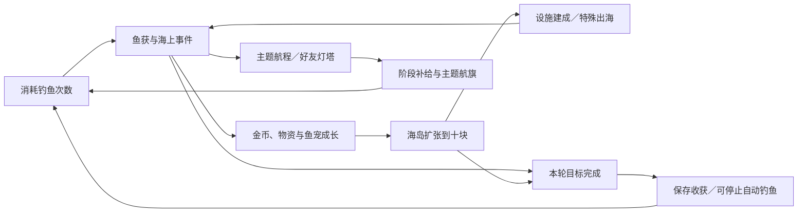

# 0.15 核心循环：航程、建设与本轮目标

本轮在现有三个主界面连接持续目标、建设后的玩法变化与一次出海的收尾，保留旧存档、四栋基础家园和原有资源。

## 每周主题航海

任务手帐顶部可进入本周航海。六个主题按现有周编号轮换：海风寻迹、港湾来信、珊瑚之约、暖流探秘、极光航线、星海回响。北京时间周一 00:00 更新，主题航旗与已获得的纪念永久保留。

每消耗一次钓鱼获得一点航程，稀有／史诗鱼每尾再加一点，实际完成攻击、偷袭、寻珠、区域奇遇、护盾或补给后加两点乘倍率；未完成事件不计完成奖励。次数消耗与品质奖励分开结算，好鱼只有实际收获时计入，保底、超时与刷新不能重复计分。收线练习仍消耗一次并按实际收获计分。

| 航程 | 奖励 |
| --- | --- |
| 10 | 4 次钓鱼、2 物资 |
| 30 | 6 鱼宠粮、3 物资 |
| 60 | 8 次钓鱼、4 鱼宠粮 |
| 100 | 本周主题航旗、5 物资；已拥有同一航旗时补 2 鱼宠粮 |
| 160 | 12 次钓鱼、6 鱼宠粮 |

每周共返还 24 次钓鱼，均须通过现有动作积累进度，五阶段每周各领一次。请求包含周编号，过期周请求不能领取新周奖励。倍率按实际投入计分，不提供单位消耗折扣。

## 建设解锁特殊出海

每座岛扩张十块后，岛上实际出现设施模型。普通出海每消耗一次，积累本海域一点观测进度；每海域分别保留，最多存下十次基础设施使用量。特殊出海消耗对应观测进度和正常钓鱼次数，不积累自己的观测。

| 岛屿设施 | ×1 所需观测 | 实际效果 |
| --- | --- | --- |
| 潮汐观测台 | 8 | 本次鱼获为优秀及以上；原有新发现保底不覆盖品质承诺 |
| 沉船打捞台 | 8 | 确定开启原有九枚贝壳匹配寻珠 |
| 珊瑚研究站 | 12 | 第一尾优先寻找未发现鱼种，其余偏向大体型；全部发现后第一尾同样偏向大体型 |
| 暖流观测站 | 8 | 鱼获体重至少达到其最小至最大范围的 80%，保持鱼种上限 |
| 极光灯塔 | 8 | 确定遇鱼，每尾实际收获额外贡献两点主题航程 |
| 星盘神殿 | 16 | 确定遇到稀有鱼，保留好鱼挑战与失败／退出保底 |

倍率同时放大观测与次数消耗；例如 ×5 潮汐出海需 40 观测及 5 次钓鱼。特殊出海从岛上设施入口或装备页主动选择，自动钓鱼继续普通出海，避免自动花掉玩家保留的观测进度。设施外形为程序化观测建筑，结合各岛既有地貌与配色，不是六套新制作的独立美术资产。

## 一次出海的目标与小结

钓鱼按钮下方“本轮目标”可查看手帐；任务 → 主题航海也可进入。可选择消耗 5／10／20 次钓鱼、领取一份每日订单、扩张一块土地。默认是十次，默认目标完成后停止自动钓鱼，可取消自动停止。

目标进度按实际扣除次数而非按钮点击计算。到达次数目标时若仍有事件或好鱼挑战，先完成或保底收获再结束本轮。手帐记录消耗次数、鱼获、新伙伴、事件、扩张、获得的默契，以及各次动作的资源净变化，保留最近三轮。目标与小结不额外发奖，不允许反复开新轮刷补给。

主动更换目标会先保存当前轮。今日订单全领或六岛全部建成时，不能选择当日无法完成的对应目标；若上次计划在自动开启新轮时已不可达，改用次数目标。手帐和停止选项随存档保存，刷新不丢失。

## 对手线索与重复鱼获

任务 → 主题航海下方提供每周一次三段手记：完成 NPC 攻击 → 从同一对手成功带回偷袭金币 → 完成一次贝壳寻珠。首段记住对手，点击“追踪”后下一次 NPC 攻击／偷袭优先选择该对手，仍由原事件抽取决定遇到哪类事件。没有选择追踪时，原四位 NPC 轮换照常运行。

完成手记领取 4 物资、4 鱼宠粮及挑战纪念章，每周一次。真人攻击与偷袭继续沿用现有保护与结算，不伪装成 NPC 手记，也不额外增加真人损失。

重复鱼每累计五次重复捕获，伙伴获得一点默契，上限 999；首次捕获不算重复。默契是原有伙伴记录，不提高等级、战力或金币倍率。刷新体重纪录会在鱼获结果提示；新发现、纪录与默契均在服务端实际收获时确认，好鱼预留与保底不会重复发放。

## 金币、物资的外观用途

海岛“布置”可选择海岛航旗、灯饰与小艇配色，购买或更换后立即反映在实际 3D 场景。原有三级地标升级也保留在该面板。

| 永久布置 | 金币 | 物资 |
| --- | --- | --- |
| 珊瑚庆典 | 12,000 | 20 |
| 极光灯会 | 28,000 | 40 |
| 金色远航 | 60,000 | 80 |

另有六枚航海主题航旗，可通过对应主题第 100 点阶段获得。纯外观不增加产出或战力，永久布置不能重复购买。

每座已扩张十块的岛可举办每周灯会，消耗 `5,000 × 岛序` 金币与 `10 × 岛序` 物资，岛序为一至六。本周实际点亮港湾灯饰，周结束后灯饰效果结束，举办次数作为永久纪念保留。每岛每周一次、没有返还资源或增益。界面在消费前明确显示价格、期限与纯外观性质，属于可选消耗。

## 真实好友共建灯塔

任务 → 主题航海 → 好友灯塔。需要两位真实注册账号互相接受好友关系，再由一方邀请、另一方主动接受；不要求开启有损失的攻击互访。接受前可取消或婉拒，接受后本周保持同一位伙伴。

双方接受后，通过实际出海与完成事件增加的主题航程共同推进灯塔，之前的航程不追溯。合计 120 点且本人至少贡献十点，即可各自领取 10 次钓鱼、5 物资、6 鱼宠粮和合作纪念章，各每周一次。UI 可刷新船友进度，没有伪造机器人好友或贡献。

贡献与领取状态存 SQLite，与原游戏事务一起提交／回滚，并沿用请求编号幂等。对方不在线时也保留已记录进度；合作不扣除任一方钱包。此功能只连接同一服务实例的真实账号，不意味着已经公开运营了玩家网络。

## 数值检查与剩余边界

`node scripts/loop-balance.mjs` 生成 [BALANCE_V015.json](BALANCE_V015.json)。四种场景各八个固定种子，模拟十四天、每天两次相隔十二小时登录、每次最多四十竿。初期对照仅建设第一岛；后期对照预设六岛、建筑及装备满级，均不是自然通关时长测试。按日期覆盖三个游戏周，新增航海奖励合计领取 72 次钓鱼。没有计算广告、付费、船长／章节／收藏补给或真实合作奖励。

在该策略中各组均完成 1,120 竿。满级对照金币结余约 34.0–40.6 万；新版主动购买三套永久外观共花费十万，灯会花费 25.5–28.5 万，结余为 16,556–53,135 金币。此结果说明可选消耗有实际承接，不证明玩家会采用相同消费策略；后期物资与鱼宠粮依然有积累，仍需真实试玩验证。

六岛、36 种鱼、十五章内容量保持不变。六个主题会轮换，收集完主题外观后仍依赖周期任务、合作、灯会与后续内容更新；本轮没有实现无限新剧情、完整赛季排行榜或成熟运营后台。仍需实体手机性能与真实游玩节奏验收。

## 浏览器运行截图

- [主题航海阶段](screenshots/loop-v15/voyage-stages.png)／[小屏](screenshots/loop-v15/voyage-small.png)
- [本轮收获与目标](screenshots/loop-v15/outing-receipt.png)／[小屏](screenshots/loop-v15/outing-small.png)
- [海岛灯会](screenshots/loop-v15/island-festival.png)／[小艇主题](screenshots/loop-v15/boat-theme.png)
- [潮汐观测台](screenshots/loop-v15/facility-0.png)／[沉船打捞台](screenshots/loop-v15/facility-1.png)／[珊瑚研究站](screenshots/loop-v15/facility-2.png)
- [暖流观测站](screenshots/loop-v15/facility-3.png)／[极光灯塔](screenshots/loop-v15/facility-4.png)／[星盘神殿](screenshots/loop-v15/facility-5.png)
- [真实测试账号合作灯塔](screenshots/loop-v15/lighthouse-ready.png)／[领奖后](screenshots/loop-v15/lighthouse-claimed.png)

由 `scripts/capture-v15.mjs` 在隔离展示数据库生成。高资源、十块土地与本轮 4/5 是界面检查夹具；合作灯塔由两位实际注册测试账号通过正常事务推进。截图使用 Chromium 软件 WebGL，不代表实体手机性能验收。
